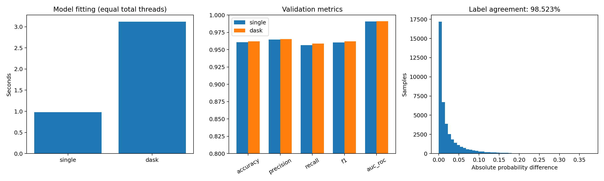

# 实际验证报告

## 环境与数据

- 平台：macOS-26.3.1-arm64-arm-64bit，Python 3.10.4。
- make_classification 样本数 200,000，种子 42；80%/20% 分层切分。原始 31 维，经仅训练集拟合的方差筛选变为 30 维。
- 总 XGBoost 线程预算 4：单机 n_jobs=4，Dask 4 Worker × n_jobs=1。
- 模型参数和版本详情见 comparison.json；双方数据和验证索引相同。

## 分类指标

| 指标 | 单机 | Dask |
| --- | ---: | ---: |
| accuracy | 0.96060000 | 0.96207500 |
| precision | 0.96444781 | 0.96516136 |
| recall | 0.95644129 | 0.95874175 |
| f1 | 0.96042786 | 0.96194084 |
| auc_roc | 0.99063721 | 0.99101006 |

## 耗时（秒）

| 阶段 | 单机 | Dask |
| --- | ---: | ---: |
| preprocessing_seconds | 0.068596 | 0.059394 |
| cluster_startup_seconds | 0.000000 | 2.094055 |
| data_distribution_seconds | 0.000000 | 0.068673 |
| fit_seconds | 0.979706 | 3.122425 |
| train 总耗时（含回收） | 1.109630 | 6.102238 |

单机 fit / Dask fit = 0.314。本次单机更快；此规模下通信、DMatrix 构造与进程管理开销不能被并行收益抵消。本报告记录最后一次顺序执行，未做多轮统计，不作跨设备或大数据性能结论。

## 一致性与验收边界

- 标签一致率：98.5225%。
- 概率绝对差：均值 0.02376735，P95 0.09526154，最大值 0.37712184。
- 这些差异超过微小浮点误差，因此不满足原题严格逐点一致的字面要求。遵循用户补充说明，保留真实分布式训练并透明记录结果，没有强制共享切点、复用单机模型或修改预测。
- 两份保存包均在训练集群关闭后重新加载，概率最大差为 0。

## 真实多 Worker 训练证据

| rank | world_size | PID | 地址 |
| ---: | ---: | ---: | --- |
| 0 | 4 | 4665 | tcp://127.0.0.1:57687 |
| 1 | 4 | 4666 | tcp://127.0.0.1:57689 |
| 2 | 4 | 4667 | tcp://127.0.0.1:57688 |
| 3 | 4 | 4668 | tcp://127.0.0.1:57686 |

证据来自 Worker 内 XGBoost collective 回调，而非仅统计集群进程数量。

## 图与复查

混淆矩阵、ROC 和特征重要性见 single/、dask/；验证索引、标签和概率见 validation_predictions.npz。
自动化测试日志和 JUnit 结果见 tests.log、tests.xml。

## 限制

输入、切分、降维在驱动内存完成；只实测同机多进程 CPU 二分类。没有大规模集群容错或网络压力测试。模型包使用 joblib，应仅加载可信来源并匹配依赖版本。
